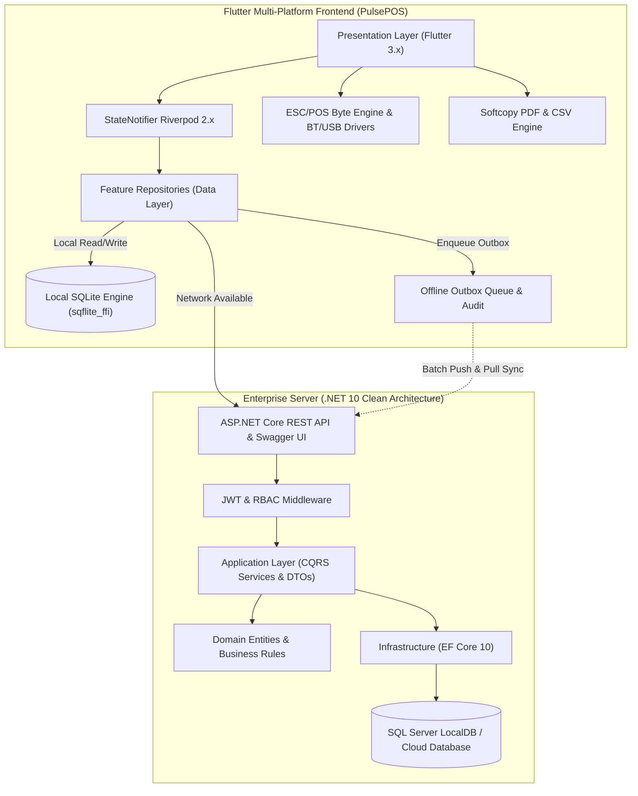
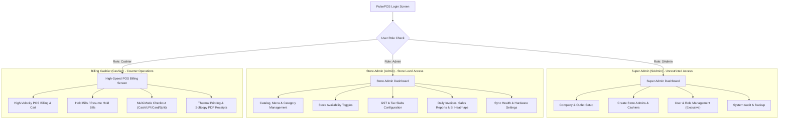
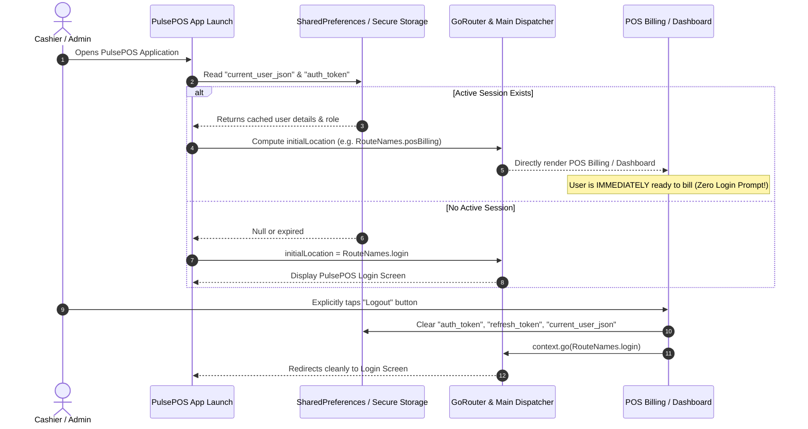
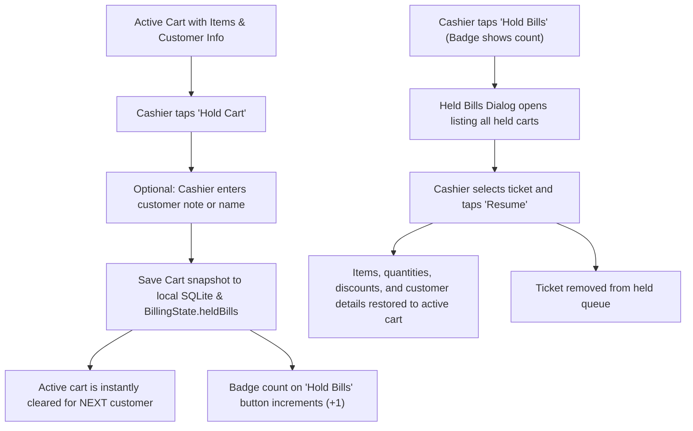
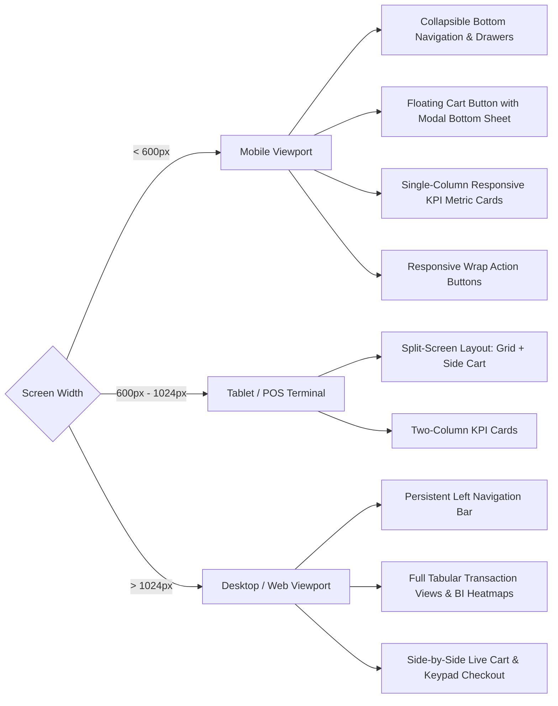

# PulsePOS — Complete End-to-End System & Architecture Documentation
*Production-Grade Offline-First Point of Sale & Retail Billing Intelligence Suite*

---

## 📑 Table of Contents
1. [Executive Overview & Brand Identity](#1-executive-overview--brand-identity)
2. [High-Level System Architecture](#2-high-level-system-architecture)
3. [Technology Stack & Prerequisites](#3-technology-stack--prerequisites)
4. [Role-Based Access Control (RBAC) & Security](#4-role-based-access-control-rbac--security)
5. [Persistent Auto-Login & Session Lifecycle](#5-persistent-auto-login--session-lifecycle)
6. [Offline-First Synchronization Engine](#6-offline-first-synchronization-engine)
7. [High-Speed POS Billing & Cart Engine](#7-high-speed-pos-billing--cart-engine)
8. [Hold Bills / Hold Cart Ticket Workflow](#8-hold-bills--hold-cart-ticket-workflow)
9. [GST Invoicing & Tax Computation Engine](#9-gst-invoicing--tax-computation-engine)
10. [Hardware, Bluetooth & ESC/POS Thermal Printing](#10-hardware-bluetooth--escpos-thermal-printing)
11. [Cross-Platform & Mobile Responsive Design System](#11-cross-platform--mobile-responsive-design-system)
12. [Reports & Business Analytics Suite](#12-reports--business-analytics-suite)
13. [Database Schema & Data Models](#13-database-schema--data-models)
14. [Testing Suite & Quality Verification](#14-testing-suite--quality-verification)
15. [Installation, Run & APK Build Guide](#15-installation-run--apk-build-guide)
16. [Troubleshooting & Support Matrix](#16-troubleshooting--support-matrix)

---

## 1. Executive Overview & Brand Identity

**PulsePOS** (formerly LitePOS) is a resilient, offline-first Point of Sale (POS) and store management platform designed for high-velocity hospitality and retail businesses including **Cafes**, **Food Courts**, **QSR (Quick Service Restaurants)**, **Ice Cream Parlours**, and **Specialty Retailers**.

### Brand Pillars
* **Lightning Velocity**: Instant product search, single-tap order additions, sub-second invoice generation, and rapid thermal receipt printing.
* **Guaranteed Uptime (Zero Cloud Dependency)**: The cashier counter never stops. Complete local offline billing using an embedded SQLite database with automatic outbox synchronization when network connectivity restores.
* **Modern Aesthetic**: Emerald/Teal dual-tone glow identity (`#0D9488` to `#10B981`) with Amber lightning pulse accents (`#FFB300`), optimized with custom typography (DM Sans) and dual Light/Dark ambient glassmorphism themes.
* **Multi-Platform Native Support**: Android mobile & tablets, POS dedicated handhelds (Sunmi, iMin, etc.), Windows Desktop (`windows-x64`), and responsive Chrome/Web POS.

---

## 2. High-Level System Architecture

PulsePOS is architected with a decoupled, enterprise Clean Architecture pattern consisting of a **cross-platform Flutter client** and an **ASP.NET Core Web API backend**.



### Clean Architecture Layers
1. **Presentation Layer (Flutter)**: Feature-sliced Riverpod state notifiers, responsive screens, dialogs, and reusable glassmorphism cards.
2. **Data & Repository Layer (Flutter)**: Unified repository contracts that switch between local SQLite queries and remote REST API calls based on network status.
3. **Backend API (`BillingPOS.Api`)**: Controllers exposing secure endpoints for Auth, Company, Users, Categories, Products, Invoices, Payments, GST, and Sync.
4. **Backend Application (`BillingPOS.Application`)**: CQRS services, FluentValidation rules, auto-mapping, and domain logic execution.
5. **Backend Domain (`BillingPOS.Domain`)**: Base auditable entities, business exceptions, tax enums, and system invariant definitions.
6. **Backend Infrastructure (`BillingPOS.Infrastructure`)**: Entity Framework Core DbContext, repository implementations, and SQL Server migrations.

---

## 3. Technology Stack & Prerequisites

| Layer | Technology | Version | Purpose |
|---|---|---|---|
| **Mobile & Desktop UI** | Flutter & Dart SDK | Dart 3.x / Flutter 3.x | Cross-platform client frontend |
| **State Management** | Flutter Riverpod | 2.5.1 | Reactive state, decoupled dependency injection |
| **Routing** | GoRouter | 14.2.0 | Declarative URL routing, role-based guards |
| **Local Database** | SQLite (`sqflite` / `sqflite_common_ffi`) | 2.3.3 | Offline-first client cache & outbox |
| **HTTP Client** | Dio | 5.4.3 | REST calls, token interceptors, retry policies |
| **Thermal Printing** | Pure ESC/POS Byte Generator | Custom Native | 80mm & 58mm thermal receipts & ESC/POS cash drawer kick |
| **Bluetooth Printing** | `flutter_blue_plus` / Android BT | 1.34.0 | Wireless thermal printer scanning and printing |
| **Backend Framework** | ASP.NET Core Web API | .NET 10.0 | High-performance backend engine |
| **ORM** | Entity Framework Core | 10.0.3 | Database mapping and transactional operations |
| **Server Database** | Microsoft SQL Server LocalDB | 2022+ | Central master relational database |
| **Security & Token** | JWT Bearer & PBKDF2/BCrypt | SHA-256 | Secure authorization and token refresh |

---

## 4. Role-Based Access Control (RBAC) & Security

PulsePOS enforces a strict, 3-tiered Role-Based Access Control model. Security checks are enforced both on the Flutter navigation layer and on the backend API controllers:



### Pre-Configured Test Credentials

| Role | Username | Password | Default Redirect Route | Permitted Capabilities |
|---|---|---|---|---|
| **Super Admin (`SAdmin`)** | `sadmin` | `SAdmin@123!` | `/sadmin/dashboard` | Setup companies, create store admins, manage all user roles, global audits. |
| **Store Admin (`Admin`)** | `admin` | `Admin@123!` | `/dashboard` | Catalog, products, GST rules, hardware setup, reports & analytics. |
| **Billing Cashier (`Cashier`)** | `cashier` | `Cashier@123!` | `/billing` | Counter billing, cart management, hold bills, payment collection, printing. |

> [!IMPORTANT]
> **User & Role Management Exclusion**: Store Admins and Cashiers are strictly restricted from viewing or altering system users and roles. Only accounts authenticated with the `SAdmin` role can view and access the User Management screen.

---

## 5. Persistent Auto-Login & Session Lifecycle

To eliminate cashier counter delays and ensure seamless operations during power cuts or app restarts, PulsePOS features **persistent automatic session restoration**:



### Guarantees
1. **Restart Safe**: Closing the application (or restarting the Android device / POS terminal) will **NEVER** log the user out. Upon reopening, the user is instantly restored to their role's active screen.
2. **Explicit Logout Only**: The application will only return to the Login Screen when the user explicitly taps the **Logout** button in the sidebar or profile dropdown.

---

## 6. Offline-First Synchronization Engine

PulsePOS operates with a dual database model:
* **Embedded SQLite**: Handles 100% of read and write traffic during active operations for lightning-fast responsiveness.
* **Central Cloud / LocalDB**: Acts as the master cloud database for multi-terminal aggregation.

### The Outbox Sync Pattern
1. When a bill is completed offline, it is written immediately to the local `LocalInvoice` and `LocalInvoiceItem` SQLite tables.
2. An entry is simultaneously written to the `SyncOutboxQueue` table with `SyncStatus = 'Pending'`, recording the entity type, operation (`INSERT`, `UPDATE`), payload, and a deterministic UUID.
3. The background sync worker (`SyncService`) periodically polls network availability:
   - When **Online**: Posts batch records to `/api/v1/sync/push`. The backend inserts records within an atomic SQL transaction and returns server IDs.
   - The client marks outbox entries as `Synced` and records a record in `SyncAuditLog`.
   - The client then calls `/api/v1/sync/pull?lastSyncUtc=...` to fetch new menu items, price updates, or tax rate changes made by Admins.

---

## 7. High-Speed POS Billing & Cart Engine

The POS Billing module is engineered for maximum throughput during rush hours.

### Capabilities
* **Instant Category Tab Switching**: Displays all active categories with product count badges.
* **Smart Search Filter**: Filters items in real-time by product name, barcode, or SKU without UI lag.
* **Line-Item Discounts**: Custom discount percentages or flat rupee reductions per item.
* **Bill-Level Discounts**: Percentage or flat discounts applied to the entire ticket.
* **Smart Rounding Off**: Automatic rounding to the nearest rupee conforming to retail standards.
* **Multi-Mode Settlements**:
  * **Cash**: Includes quick cash tender buttons (₹100, ₹200, ₹500, ₹2000) and instant change calculation.
  * **UPI QR**: Generates dynamic UPI intent QR codes compliant with NPCI specifications (`upi://pay?pa=...&pn=...&am=...&cu=INR`).
  * **Card / POS Terminal**: Supports external swipe/chip card terminals.
  * **Split Payments**: Distribute payment across Cash + UPI or Cash + Card.

---

## 8. Hold Bills / Hold Cart Ticket Workflow

During counter operations, a customer may need to step aside to pick up additional items or check payment apps. PulsePOS includes a dedicated **Hold Bills** mechanism so cashiers never lose cart progress:



### Nomenclature Consistency
* **Status Badge**: Displayed as **`HOLD BILL`** on transaction lists and invoice items.
* **Button & Dialog**: Displayed as **`Hold Bills`** with real-time badge counts and a dedicated `Hold Cart Tickets` summary metric on the Cashier Dashboard.

---

## 9. GST Invoicing & Tax Computation Engine

PulsePOS complies fully with the Indian Goods and Services Tax (GST) framework:

### Tax Calculation Rules
* **Intra-State Transactions** (Shop and Customer within same State):
  $$\text{CGST} = \frac{\text{Taxable Amount} \times \text{GST Rate}}{200}$$
  $$\text{SGST} = \frac{\text{Taxable Amount} \times \text{GST Rate}}{200}$$
* **Inter-State Transactions** (Shop and Customer in different States):
  $$\text{IGST} = \frac{\text{Taxable Amount} \times \text{GST Rate}}{100}$$
* **HSN/SAC Validation**: Every menu item and product is mapped to a compliant HSN/SAC code (e.g., `2105` for Ice Cream, `2106` for Sweets, `9963` for Restaurant Services).
* **Sequential Tax Invoice Numbering**: Automated daily sequence generator following the standard `INV-YYYY-XXXX` format.

---

## 10. Hardware, Bluetooth & ESC/POS Thermal Printing

PulsePOS contains a built-in, native **ESC/POS byte generator** requiring no external third-party printing applications:

### ESC/POS Command Sequences

| Command | Hex Bytes | Description |
|---|---|---|
| **Initialize Printer** | `1B 40` | Resets printer buffer, font styles, and line spacing. |
| **Align Left** | `1B 61 00` | Aligns text to the left margin. |
| **Align Center** | `1B 61 01` | Centers headers, shop name, and UPI QR codes. |
| **Align Right** | `1B 61 02` | Aligns invoice totals and balance due. |
| **Bold ON / OFF** | `1B 45 01` / `1B 45 00` | Emphasizes invoice number, totals, and greetings. |
| **Double Height/Width** | `1D 21 11` | Headline font for shop name at top of ticket. |
| **Cash Drawer Kick** | `1B 70 00 19 FA` | Sends a 24V pulse to pin 2 of the RJ11 drawer port. |
| **Paper Cut (Partial)** | `1D 56 42 00` | Feeds paper and performs a clean partial cut. |

### Paper Roll Width Options
* **80mm Standard Rolls**: 48 columns per line. Supports rich tabular layout (`Item | Qty | Rate | Amount`).
* **58mm Compact Rolls**: 32 columns per line. Optimized compact format for portable Bluetooth printers.

### Thermal Printer Setup Guide (Self-Test Receipt)
For standard 58mm portable Bluetooth printers (such as the *PMN-1.5-EC2518 / LS* shown in the hardware diagnostic):
1. **Power On Printer**: Press and hold the power button until the green LED turns solid.
2. **Obtain Hardware Specs**: Hold the *Feed* button while powering on to print the self-test slip. Verify:
   * **Bluetooth Name**: `LS` (or similar)
   * **Default PIN**: `0000` or `1234`
   * **Interface**: `USB & Bluetooth`
   * **Command Support**: `EPSON(ESC/POS)`
3. **Pair in Android Settings**:
   * Open Android Settings $\rightarrow$ Bluetooth $\rightarrow$ Pair New Device.
   * Select `LS`, enter PIN `0000`, and confirm pairing.
4. **Select in PulsePOS**:
   * Navigate to **Hardware & Printers** in PulsePOS.
   * Tap **Scan Bluetooth Printers** $\rightarrow$ select `LS`.
   * Set Roll Width to **58mm** and tap **Print Test Receipt**.

---

## 11. Cross-Platform & Mobile Responsive Design System

The application dynamically adapts its UI depending on screen geometry using a robust layout builder:



---

## 12. Reports & Business Analytics Suite

PulsePOS provides store owners with actionable insights:
* **Real-Time KPIs**: Total Gross Revenue, Net Sales, Tax Collected, Completed Invoices, Average Ticket Value, and Void/Cancelled Transactions.
* **Hourly Sales Heatmap**: Identifies peak counter traffic hours (breakfast, lunch, evening tea, and dinner rush).
* **Payment Mode Breakdown**: Distribution of Cash, UPI, and Card transactions with exact percentage splits.
* **Cashier Performance**: Metrics tracking sales volume, average bill turnaround time, and cash drawer balance per cashier.
* **Digital Softcopy Export**: Instant export of reports to PDF softcopy and CSV spreadsheets for accountant auditing.

---

## 13. Database Schema & Data Models

### Key Local SQLite Tables (`app_database.dart`)

```sql
-- Local Invoices Table
CREATE TABLE local_invoices (
    id INTEGER PRIMARY KEY AUTOINCREMENT,
    invoice_number TEXT NOT NULL UNIQUE,
    shop_id INTEGER NOT NULL,
    company_id INTEGER NOT NULL,
    cashier_id INTEGER NOT NULL,
    customer_id INTEGER,
    customer_name TEXT NOT NULL,
    customer_mobile TEXT NOT NULL,
    sub_total REAL NOT NULL,
    discount_amount REAL NOT NULL,
    tax_amount REAL NOT NULL,
    round_off REAL NOT NULL,
    grand_total REAL NOT NULL,
    payment_mode TEXT NOT NULL,
    invoice_status TEXT NOT NULL, -- 'Active', 'Hold', 'Cancelled'
    sync_status TEXT NOT NULL,    -- 'Pending', 'Synced'
    created_at TEXT NOT NULL
);

-- Local Invoice Items Table
CREATE TABLE local_invoice_items (
    id INTEGER PRIMARY KEY AUTOINCREMENT,
    invoice_id INTEGER NOT NULL,
    product_id INTEGER NOT NULL,
    product_name TEXT NOT NULL,
    hsn_code TEXT NOT NULL,
    quantity INTEGER NOT NULL,
    unit_price REAL NOT NULL,
    discount_amount REAL NOT NULL,
    tax_rate REAL NOT NULL,
    tax_amount REAL NOT NULL,
    line_total REAL NOT NULL,
    FOREIGN KEY(invoice_id) REFERENCES local_invoices(id) ON DELETE CASCADE
);

-- Offline Outbox Queue Table
CREATE TABLE sync_outbox (
    id INTEGER PRIMARY KEY AUTOINCREMENT,
    entity_id TEXT NOT NULL,
    entity_type TEXT NOT NULL, -- 'Invoice', 'Customer', 'Product'
    operation TEXT NOT NULL,   -- 'INSERT', 'UPDATE', 'DELETE'
    payload TEXT NOT NULL,
    status TEXT NOT NULL,      -- 'Pending', 'Processing', 'Synced', 'Failed'
    created_at TEXT NOT NULL
);
```

---

## 14. Testing Suite & Quality Verification

PulsePOS maintains a **100% test pass rate** across all backend and frontend modules:

| Test Target | Framework | Total Tests | Status | Verification Summary |
|---|---|:---:|:---:|---|
| **Backend API & Domain** | xUnit & FluentAssertions (.NET 10) | **149** | 🟢 Pass | Controller endpoints, auth guards, repository queries, GST tax splits, outbox queue. |
| **Frontend State & UI** | Flutter Test Framework | **162** | 🟢 Pass | Cart math, Riverpod notifiers, widget responsiveness, hardware ESC/POS, persistent session. |
| **Static Code Analysis** | `flutter analyze` | — | 🟢 0 Issues | 100% clean linter score with zero warnings and zero deprecations. |

---

## 15. Installation, Run & APK Build Guide

### 1. Running the ASP.NET Core Backend

```powershell
# Navigate to the API root
cd D:\LitePOS-main\BillingPOS\BillingPOS.Api

# Restore and launch API server
dotnet run --urls "http://localhost:5270"
```
* **Swagger Documentation**: [http://localhost:5270/swagger](http://localhost:5270/swagger)
* **Health Endpoint**: [http://localhost:5270/api/v1/health](http://localhost:5270/api/v1/health)

### 2. Running the Flutter Client on Desktop or Web

```powershell
cd D:\LitePOS-main\billing_pos_app

# Run on Chrome
flutter run -d chrome

# Run on Windows Desktop
flutter run -d windows
```

### 3. Compiling the Production Android Release APK

```powershell
# Configure environment variables
$env:JAVA_HOME = "C:\Program Files\Microsoft\jdk-17.0.21.21-hotspot"
$env:ANDROID_HOME = "C:\Users\MICROSOFT\AppData\Local\Android\Sdk"
$env:GRADLE_USER_HOME = "D:\.gradle"

cd D:\LitePOS-main\billing_pos_app

# Build APK without icon tree-shaking
flutter build apk --release --no-tree-shake-icons

# Output APK Location:
# D:\LitePOS-main\billing_pos_app\build\app\outputs\flutter-apk\app-release.apk
# Direct Root Copy:
# D:\LitePOS-main\LitePOS-release.apk
```

---

## 16. Troubleshooting & Support Matrix

| Symptom / Error | Root Cause | Solution |
|---|---|---|
| **"Connection timeout operating offline"** | Backend server is not running on the specified IP, or mobile device cannot reach `localhost`. | Tap the **Server & Network Settings** icon on the Login Screen and set your PC's local WiFi LAN IP (e.g., `http://192.168.1.100:5270`). Alternatively, toggle **Work Offline** to bill with local cached credentials. |
| **Printer fails to connect via Bluetooth** | Printer is not paired in Android Bluetooth settings or wrong PIN entered. | Print printer self-test slip (hold Feed + Power). Pair device in Android Bluetooth using PIN `0000` or `1234`. Open PulsePOS Hardware Settings, scan, and select the paired device. |
| **"User & Role Management not visible"** | Current logged-in account has `Admin` or `Cashier` role. | Log in with the Super Admin account (`sadmin` / `SAdmin@123!`). User & Role management is exclusively reserved for `SAdmin`. |
| **Session logs out on app close** | Corrupted SharedPreferences or explicit logout executed. | PulsePOS now automatically persists session tokens in local storage. Simply open the app and it will restore directly to your dashboard or POS billing screen. |

---
*PulsePOS — Engineered for high-speed retail intelligence and uninterrupted counter operations.*
